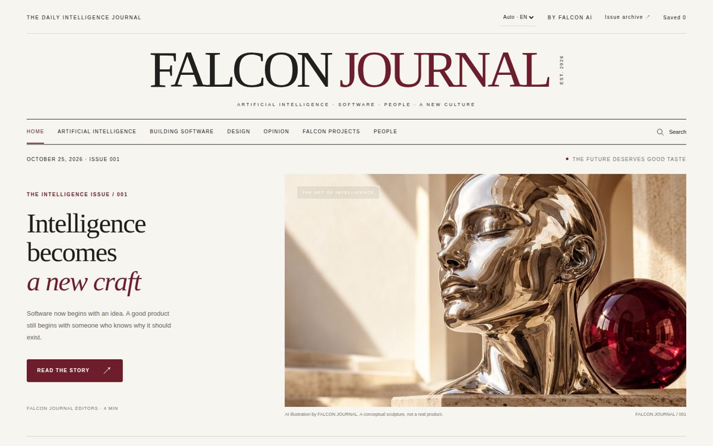
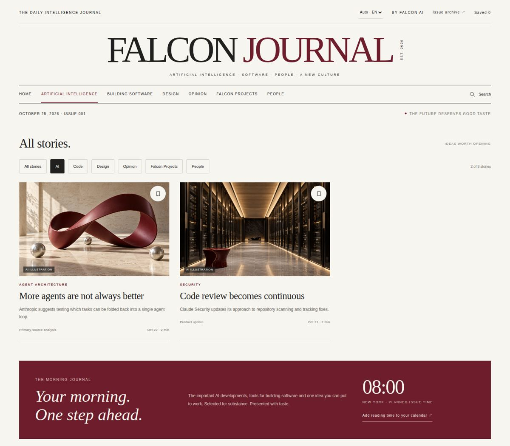
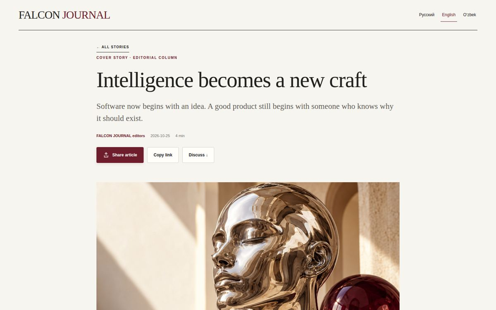
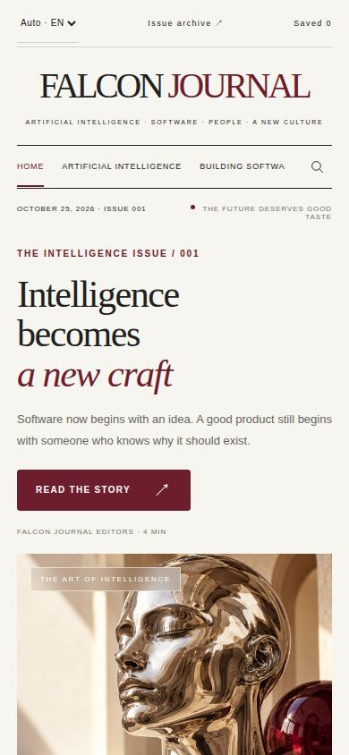
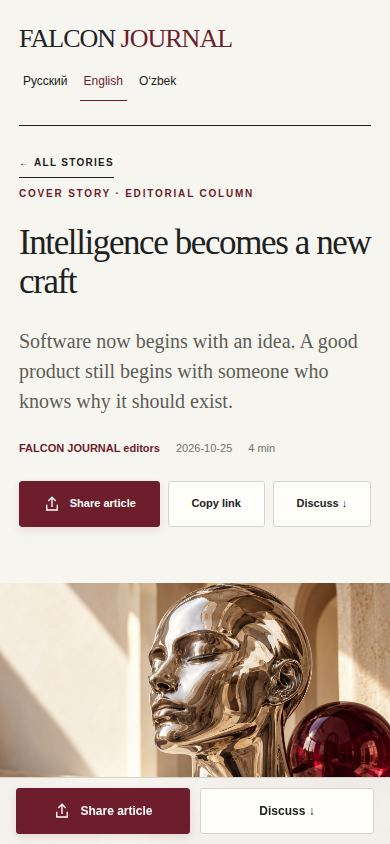

# Falcon Brand System 0.3 — черновик по мотивам Falcon Journal

Статус: **черновик на согласовании** (12.11.2026). Действующая версия — 0.2 (`preview/`, `tokens/`, `dist/`), она не изменена. Живой предпросмотр черновика: `next/index.html`, на проде https://work.falconai.app/brand/next/.

Задача Юрия: «falcon journal взять как inspiration для нового брендбука».

## 1. Разбор Falcon Journal

Источник: https://falconjournal.today (главная, рубрика, статья; 1440 и 390), стили страницы и репозиторий FalconAI-team/falcon-journal. Журнал только читался, в нём ничего не менялось. Тёмной темы у журнала нет.

### Что измерено

| Что | Значение |
|---|---|
| Цвета | бумага `#F7F5F0`, лист `#FFFEFA`, чернила `#20211E`, серый `#72716A`, линия `#D6D3CB`, акцент `#6D1D2B` |
| Шрифты | Georgia (заголовки), Arial (всё остальное) — системные, без файлов |
| Титул | Georgia, `clamp(50px, 7.2vw, 112px)`, интерлиньяж 0,86, разрядка −7 px; второе слово бордовое |
| Заголовок обложки | Georgia, `clamp(40px, 3.85vw, 59px)` / 1,05, −1,8 px; последняя строка курсивом и бордовым |
| Заголовок материала | Georgia 27 px / 1,13 |
| Основной текст | Arial 13 px / 1,85; колонка обложки до 295 px |
| Рубрики и метки | Arial 9–10 px, прописные, разрядка 1,3–3,1 px, бордовые |
| Подписи к картинкам | 9 px, серые |
| Сетка | контейнер до 1536 px, поля 54 px; обложка «узкий текст + широкая картинка»; три карточки по 424 px с промежутком 30 |
| Линии | 1 px чернильная над и под навигацией, 1 px светлая между блоками |
| Кнопки | бордовые или чернильные, скругление 2 px, прописные с разрядкой |
| Статья | колонка около 650 px, заголовок антиквой 44–48 px, вводка антиквой 20 px / 1,5 серым, цитата антиквой на тонированной плашке с бордовой линией слева |

| Главная, 390 | Статья, 390 |
|---|---|
|  |  |

### Что делает его сильным

1. **Один акцент.** Бордовый встречается на экране в трёх–четырёх местах: слово в титуле, рубрика, курсивная строка, одна плашка. Остальное — бумага и чернила. Поэтому глаз сразу находит главное.
2. **Контраст кеглей.** Титул 104 px рядом с метками 9–10 px. Среднего размера почти нет: либо крупно и антиквой, либо мелко и прописными. Это и создаёт ощущение издания.
3. **Линия вместо коробки.** Навигация зажата между двумя чернильными линиями, материалы разделены светлыми. Карточек с тенями нет, страница дышит.
4. **Асимметрия.** Узкая колонка текста (295 px) рядом с широкой картинкой. Пустое место справа от двух карточек в рубрике не заполняется — и это выглядит уверенно.
5. **Единый мир картинок.** Камень, хром, бордовый предмет, дневной свет. Картинки из разных материалов читаются как одна серия.
6. **Честная подпись.** На каждой картинке плашка «AI ILLUSTRATION», под обложкой — «A conceptual sculpture, not a real product».
7. **Тон.** Заголовки — утверждения, а не обещания: «More agents are not always better», «Code review becomes continuous». Подвал: «We check primary sources, separate facts from opinions».

### Что в журнале слабо (и в бренд не берётся)

- Текст 13 px и подписи 9 px: мелко, на телефоне читать трудно. Серый `#72716A` на бумаге даёт контраст 4,5 : 1 — ровно на пороге для мелкого текста, без запаса.
- Georgia и Arial — системные: на Android и Linux подменяются другими шрифтами, вид плывёт.
- Отрицательная разрядка титула (−7 px) держится только в латинице прописными; в кириллице буквы слипаются.
- Нет тёмной темы.
- Рубрика прописными стоит почти над каждым блоком и местами ничего не сообщает.

## 2. Сравнение с Falcon Brand System 0.2

| | Журнал | 0.2 | Черновик 0.3 | Решение |
|---|---|---|---|---|
| Фон и текст | тёплая бумага, чернила | холодный холст `#F3F4F2`, тёмные острова `#101213` | бумага `#F6F3EC`, чернила `#1E1F1C` | берём |
| Акцент | бордовый `#6D1D2B` | янтарь `#FFB020` | бордовый — голос; янтарь — сигнал (глаз сокола, «идёт сейчас») | **спорно, решает Юрий** |
| Заголовки | Georgia | Tektur | Source Serif 4 | **спорно, решает Юрий** |
| Текст, интерфейс | Arial 13 | IBM Plex Sans 16 | IBM Plex Sans 16 | не берём у журнала |
| Данные | — | IBM Plex Mono | IBM Plex Mono | как было |
| Разделение блоков | линии | карточки, скругления, тени | линии; рамка только у нажимаемого и у данных | берём |
| Рубрики прописными | над каждым блоком, 9–10 px | нет | 11 px, одна на блок | берём с правкой |
| Курсив с цветом в заголовке | на обложке | нет | один раз на страницу; не в интерфейсе | берём с правкой |
| Картинки | предметы в дневном свете, ИИ | 128 линейных иллюстраций FAI | оба рода: обложки — редакционные, интерфейс — FAI | берём |
| Титул-шапка | 104 px по центру | нет | только сайт компании и брендбук | в продукты не берём |
| Тёмная тема | нет | есть, холодная | есть, тёплая (`#151412`) | сохраняем |
| Логотип | своя надпись антиквой | знак сокола и надпись | знак и надпись 0.2 без изменений | не трогаем |
| Компоненты `fa-*` | — | кнопки, поля, таблицы, листы и т. д. | не переделывались | отдельная работа после решения |

### Что переносится и почему

- **Бумага, чернила, линии, воздух** — это не свойство издания, а способ организовать страницу. Работает на сайте, в письмах, презентациях и в спокойных экранах продукта.
- **Антиква в заголовках** — даёт голос. Но только там, где есть что читать: заголовок экрана, крупное число, обложка. В кнопках, полях, таблицах остаётся гротеск.
- **Один акцент** — правило, а не цвет. Его можно принять и с янтарём; бордовый выбран потому, что на бумаге им можно набирать текст (10,2 : 1), а янтарём нельзя (1,7 : 1).
- **Подпись у каждой картинки** — переносится целиком.

### Что не переносится

- **Мелкий кегль и плотность издания.** Интерфейсом работают часами; текст 16 px, подписи от 12 px.
- **Титул и навигация-рубрикатор.** В продукте шапка — рабочий инструмент.
- **Курсив и прописные как сквозной приём.** В интерфейсе это шум.
- **Системные шрифты.** Нужен один и тот же вид на всех устройствах и кириллица.

### Где расходятся сейчас

Журнал и продукты Falcon выглядят как две разные компании: тёплое против холодного, антиква против технического Tektur, бордовый против янтаря, линии против карточек. Черновик 0.3 сводит их в одну систему, сохраняя логотип, гротеск, моноширинный шрифт, иллюстрации FAI и тёмную тему из 0.2.

## 3. Что в черновике

`next/index.html` — живой предпросмотр: принципы, логотип и охранные поля, цвет (светлая и тёмная палитры, доли, контраст), типографика, сетка и ритм, иллюстрации и фото, голос и тон, применение (сайт, приложение, слайды 16:9, посты 1:1, аватар отправителя, RCS, письмо), таблица «что взято», лицензии.

`next/tokens.next.json` — черновые токены. В сборку `dist/` не входят.

`node scripts/check-next.mjs` (`npm run check:next`) — контраст 21 пары цветов по WCAG, совпадение токенов со стилями, наличие всех файлов, на которые ссылается страница.

## 4. Что спорно

1. **Бордовый вместо янтаря как главный акцент.** Янтарь — узнаваемый цвет действующих продуктов и глаз сокола. Смена акцента — самое заметное изменение; делать её стоит только вместе с переводом продуктов.
2. **Антиква вместо Tektur.** Tektur даёт «технический» характер, антиква — «редакционный». Это смена характера бренда, а не шрифта.
3. **Права на картинки ИИ.** Сервис, которым сделаны обложки журнала, не записан; охрана таких картинок авторским правом в США под вопросом. См. `next/NOTICE.md`.
4. **Приёмы журнала — общее место.** Бумажный фон, антиква, волосные линии и мелкие прописные сейчас встречаются у многих; отличает Falcon не сам набор, а знак сокола, бордовый с янтарной искрой и серия картинок. Если серию картинок не развивать, вид станет типовым.
5. **Тёмная тема придумана заново** — у журнала её нет, сверять не с чем.
6. **Компоненты не переделаны.** Черновик показывает направление на макетах; кнопки, поля, таблицы `fa-*` под него не переписаны.

## 5. Вопросы Юрию

1. Главный акцент: бордовый (янтарь остаётся сигналом) или янтарь остаётся главным, а из журнала берём только бумагу, антикву и линии?
2. Tektur уходит из заголовков или остаётся для продуктов, а антиква — только для сайта, журнала и презентаций?
3. Каким сервисом сделаны обложки журнала? От этого зависит, можно ли их ставить в рекламу и печать.
4. С чего начинать перевод, если черновик принят: сайт falconai.app, презентации или один продукт?
